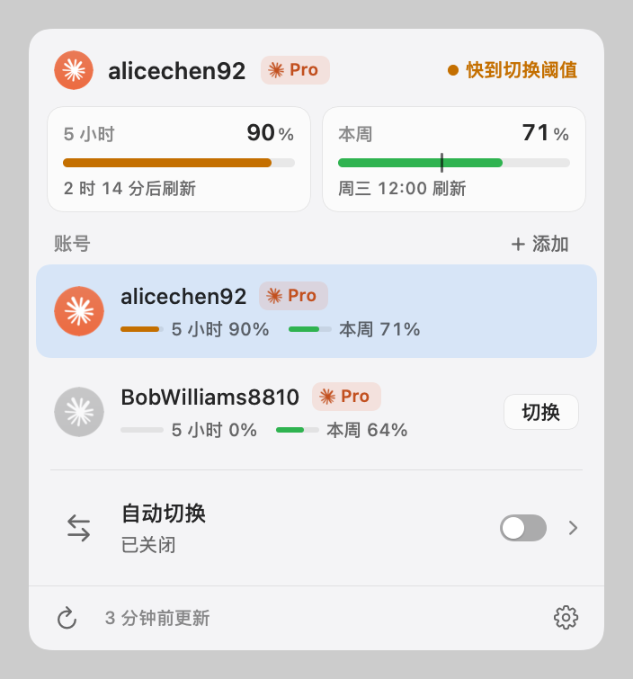
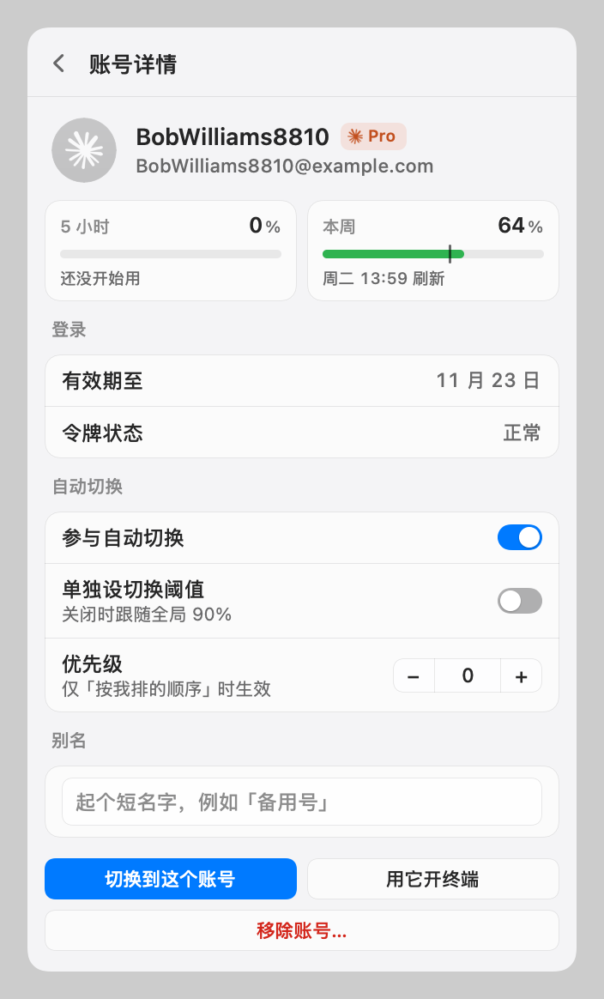
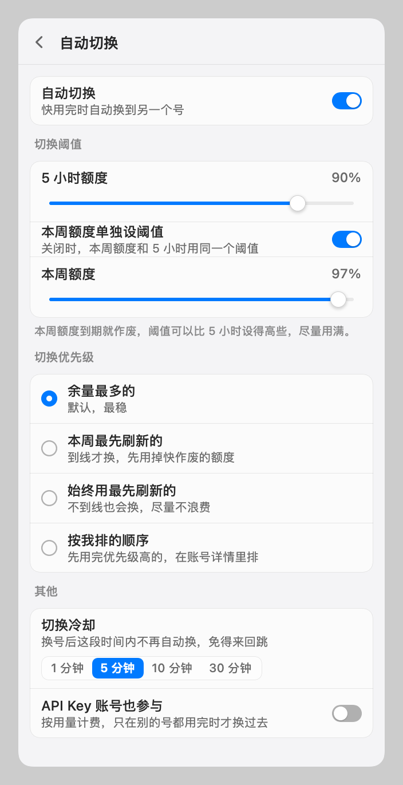
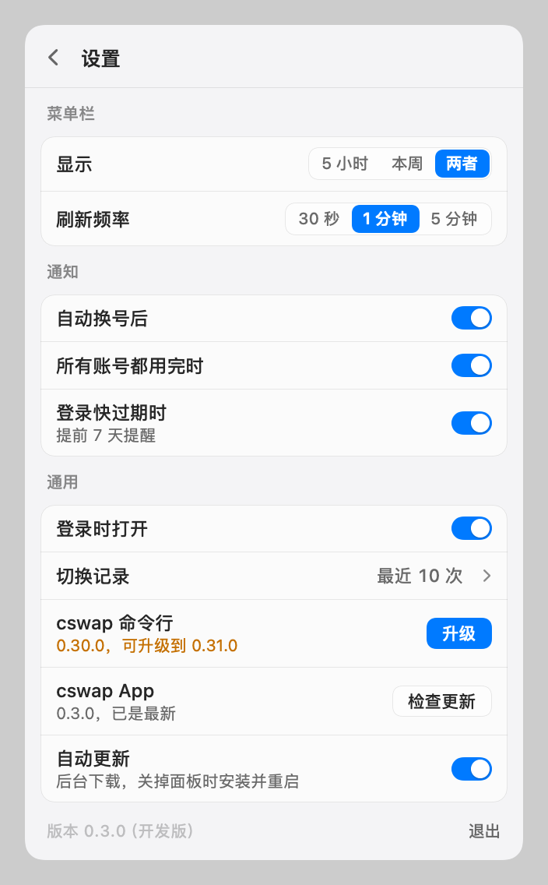
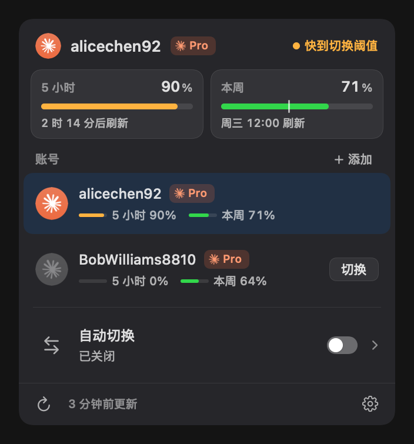

# cswap

**Claude Code 账号切换（搭配 Claude-cswap）**。更新记录见 [CHANGELOG.md](CHANGELOG.md)。

macOS 菜单栏 App：给 Claude Code 多账号切换命令行 [claude-swap](https://github.com/realiti4/claude-swap)（`cswap`）做的原生图形界面，替换它自带的纯文字菜单栏。核心逻辑全部交给命令行，App 负责好看、好用，以及命令行不提供的部分。

## 截图

| 主面板 | 账号详情 | 自动切换 | 设置 |
|---|---|---|---|
|  |  |  |  |



截图里的账号是虚构的示例数据。

## 安装

需要 macOS 14 以上，并先装好 cswap：`uv tool install 'claude-swap[menubar]'`。

1. 到 [Releases](https://github.com/Tespera/cswap-menubar/releases/latest) 下载 `cswap-<版本>.zip`，解压后把 `cswap.app` 拖进「应用程序」。
2. App 用自签名证书签名、没有经过苹果公证，第一次打开会被拦下：到「系统设置 → 隐私与安全性」点「仍要打开」；或在终端运行 `xattr -dr com.apple.quarantine /Applications/cswap.app`。
3. 之后的新版本由 App 自己在后台下载安装（设置里可以关掉自动更新）。

## 构建与使用

```bash
swift test                          # 单元测试（Swift Testing，用 fixtures/ 真实输出）
swift run cswap-app                 # 开发运行（菜单栏出现图标）
swift run cswap-app --dump          # 不显示界面，打印对当前状态的理解后退出（只读）
swift run Snapshot /tmp/cswap-shots # 各场景面板截图（浅 / 深色）+ 菜单栏图标
tools/package.sh                    # 打包 cswap.app；加 install 安装到 /Applications 并启动
tools/package.sh release            # 发布：打 v<版本> 标签并推送，CI 打包、签名、发 GitHub Release
```

- 自动切换开关是 App 自己的设置：打开后 App 启动并看护 `cswap auto --json`；切换规则全部读 cswap 的 `autoswitch.*` 设置。
- App 的数据在 `~/Library/Application Support/cswap/`（切换记录、账号显示名、登录过期提醒记录），偏好在 UserDefaults 域 `com.eric.cswap`。
- 时间一律按本机系统时区（`/etc/localtime`）显示，App 调 cswap 时也去掉 TZ。已知限制：在设了 `TZ` 的终端里手动跑 cswap 换号，日志按那个时区记，这类记录在「切换记录」里会差几个小时（日志本身分不清）。

## 代码结构

| 目录 | 内容 |
|---|---|
| `Sources/CswapCore` | 纯逻辑：解码（Models）、状态→界面映射（Overview）、文案格式（Format）、auto 事件与优先级解析、切换记录合并与通知文案（SwitchLog）、命令参数与错误（Commands） |
| `Sources/CswapUI` | 面板数据模型（PanelModel，`@Observable`）、视图（Views/）、调用 cswap（Services/CLI）、自动切换看护（Services/AutoSwitchService）、通知 / 登录时打开 / 版本检测 / 终端 / 记录存储（Services/SystemServices）、对话框、菜单栏图标绘制 |
| `Sources/CswapApp` | 入口：NSStatusItem + 毛玻璃 NSPanel、单实例 |
| `Sources/Snapshot` | 开发工具：按场景渲染面板 PNG |
| `Tests/CswapCoreTests` | Core 的单元测试 |
| `tools/package.sh` | 打包 / 安装 |

## 文档

| 文档 | 内容 |
|---|---|
| [docs/01-产品方案.md](docs/01-产品方案.md) | 做什么、为什么、给谁用、范围、已知事实 |
| [docs/02-功能清单.md](docs/02-功能清单.md) | 全部功能，逐项标明来源（命令行 / App 自建）与优先级 |
| [docs/03-界面与设计规范.md](docs/03-界面与设计规范.md) | 字号、颜色、状态判定、头像与档位徽章、文案表、交互 |
| [docs/04-技术方案.md](docs/04-技术方案.md) | 架构、工程结构、调用命令行、自动切换子进程、打包签名、风险 |
| [docs/05-cswap命令行对接.md](docs/05-cswap命令行对接.md) | 每条命令、JSON 字段、必须遵守的坑（依据 0.30.0 源码核对） |
| [docs/06-实施计划.md](docs/06-实施计划.md) | P0–P6 阶段与验收标准 |
| [docs/07-决策记录.md](docs/07-决策记录.md) | 拍板的结论、被否的方案、用户的逐条设计要求 |

## 目录

| 路径 | 内容 |
|---|---|
| `design-demos/a4.html` | **定稿设计稿**（浏览器打开，可切场景与浅 / 深色）；同目录其他文件是被否掉的历史稿 |
| `assets/` | Claude 托盘模板图（取自 Claude.app）、Claude 星形图标 |
| `fixtures/` | 本机 cswap 0.30.0 的真实命令输出，写解析代码与测试用 |

## 依赖

- claude-swap ≥ 0.30.0（本机：`uv tool install 'claude-swap[menubar]'`，阿里云 PyPI 镜像）
- 风格与工程做法参考 `/Volumes/Work/VibeCoding/NetHub`（`Sources/NetHubUI/Theme.swift`、`Package.swift`、`tools/package.sh`）
