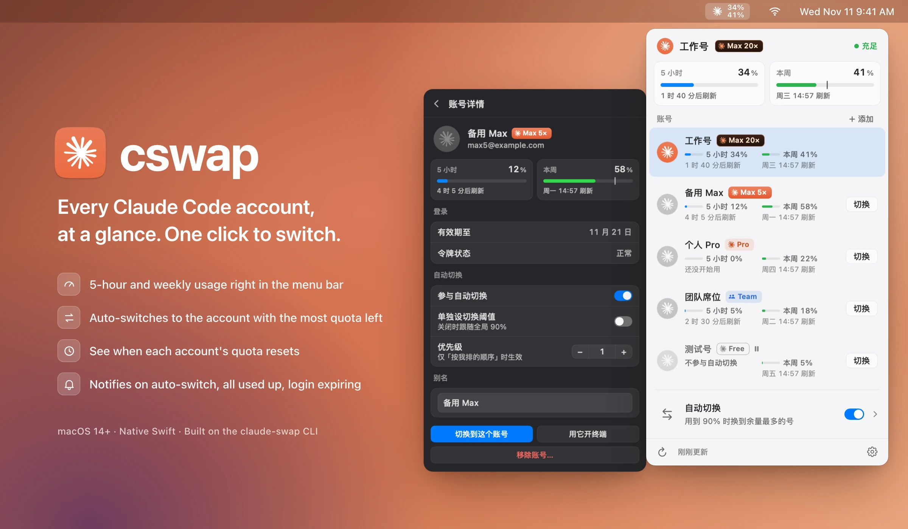
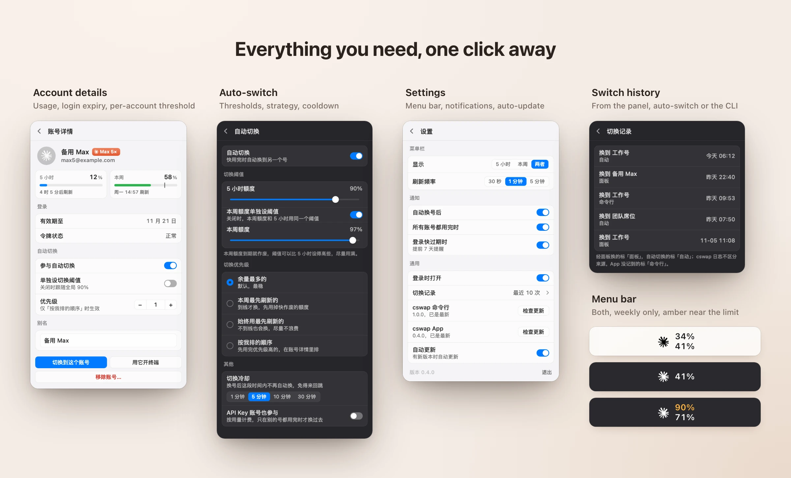

<div align="center">

# cswap

**A native macOS menu bar app for juggling multiple Claude Code accounts.**

See every account's usage at a glance, switch with one click, and let it switch for you before you hit the limit.

[**Download**](https://github.com/Tespera/cswap-menubar/releases/latest) · [Changelog](CHANGELOG.md) · English | [简体中文](README.zh-CN.md)

</div>



## Why

If you run Claude Code on more than one account, you are constantly asking: *how much is left on this one, which one resets first, which one should I switch to?* [claude-swap](https://github.com/realiti4/claude-swap) (`cswap`) answers these from the terminal. cswap (this app) puts the answers in your menu bar and turns them into one-click actions.

## Features

- **Usage in the menu bar**: the current account's 5-hour and weekly usage, turning amber near your switch threshold and red when used up.
- **Every account in one panel**: usage bars and reset times for all accounts, so you can tell which one recovers first without opening anything.
- **One-click switching** from the list, plus right-click actions: open a terminal as that account, set a display name, copy email, remove.
- **Auto-switch**: when the current account reaches your threshold, cswap moves you to another one. Choose how: most quota left, weekly reset first, always use the earliest reset, or your own priority order. Set separate thresholds for the 5-hour and weekly windows, and a cooldown so it doesn't bounce back and forth.
- **Heads-up before you run out**: "at this pace you'll run out Tue 09:55" when you're burning through the week faster than it resets.
- **Notifications** for auto-switches, all accounts used up, and logins about to expire.
- **Switch history**: every switch, whether it came from the panel, auto-switch or the command line.
- **Stays up to date by itself**, and can upgrade the cswap command line for you too.



> The interface is currently in Simplified Chinese. Accounts in the screenshots are made-up sample data.

## Install

**Requirements**: macOS 14 or later, and claude-swap 0.30.0 or later:

```bash
uv tool install claude-swap
```

1. Download `cswap-<version>.zip` from [Releases](https://github.com/Tespera/cswap-menubar/releases/latest), unzip it and drag `cswap.app` into Applications.
2. The app is signed with a self-signed certificate and not notarized by Apple, so macOS blocks the first launch. Open **System Settings → Privacy & Security** and click **Open Anyway**, or run:
   ```bash
   xattr -dr com.apple.quarantine /Applications/cswap.app
   ```
3. That's it. New versions download and install themselves in the background (you can turn this off in Settings).

## Getting started

- **Add an account**: log in to the account in Claude Code as usual, then click **+ 添加 (Add)** in the panel. Repeat for each account.
  Don't run `/logout` before logging in to the next account: it may revoke the previous account's login, and you'd have to log in to it again.
- **Switch**: click **切换 (Switch)** on any row. Click a row for its details.
- **Auto-switch**: flip the switch at the bottom of the panel; click the row to set thresholds and strategy.

## FAQ

**Does it replace claude-swap?**
No. cswap runs the `cswap` command for everything: reading usage, switching, auto-switch. It never touches your credentials or keychain directly. Things the command line doesn't offer (display names, switch history, notifications) are handled by the app itself.

**claude-swap already has a menu bar. Do I need both?**
No. Once you're happy with this app, turn off the built-in one with `cswap menubar --uninstall-service`.

**What does "login valid until" mean?**
When the saved login for that account expires and you need to log in again. It is not your subscription's renewal date.

**Where is my data?**
Display names and switch history are in `~/Library/Application Support/cswap/`. The app itself only goes online to check this repo's GitHub Releases for updates; reading usage is done by the `cswap` command.

**How do I uninstall?**
Quit cswap from Settings, delete `cswap.app`, and optionally remove `~/Library/Application Support/cswap/`. Your accounts stay in claude-swap.

## Build from source

Needs only the Xcode Command Line Tools (no Xcode):

```bash
swift run cswap-app        # run in the menu bar
tools/package.sh install   # build cswap.app and install it to /Applications
```

Architecture, design specs and release process: [docs/08-开发指南.md](docs/08-开发指南.md) (in Chinese).

## Credits

Built on [claude-swap](https://github.com/realiti4/claude-swap) by realiti4. Not affiliated with Anthropic; Claude is a trademark of Anthropic.
