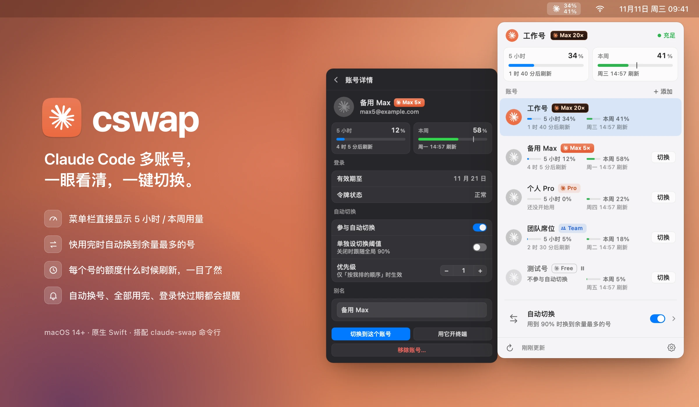
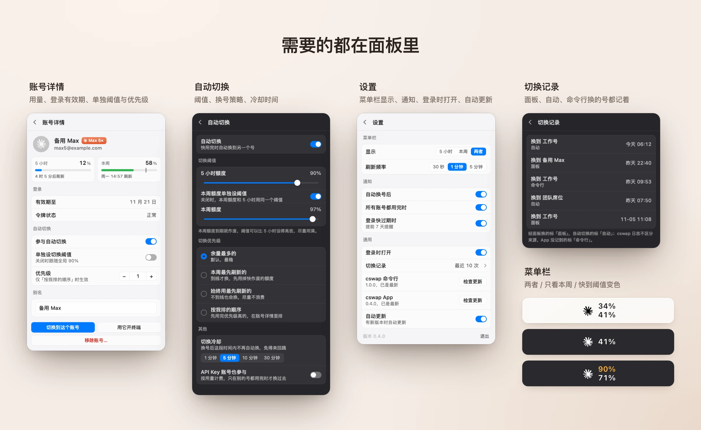

<div align="center">

# cswap

**Claude Code 多账号的 macOS 菜单栏 App（原生）。**

每个号还剩多少、什么时候刷新，一眼看清；一键切换，快用完时替你自动换号。

[**下载**](https://github.com/Tespera/cswap-menubar/releases/latest) · [更新记录](CHANGELOG.md) · [English](README.md) | 简体中文

</div>



## 为什么做它

同时用好几个 Claude Code 账号时，总在问同样的问题：这个号还剩多少？哪个号先刷新？该换到哪个？[claude-swap](https://github.com/realiti4/claude-swap)（`cswap`）在终端里能回答这些。这个 App 把答案放到菜单栏，换号只要点一下。

## 功能

- **菜单栏直接看用量**：当前账号的 5 小时、本周用量；快到切换阈值变橙，用完变红。
- **所有账号一个面板**：每个号的用量条和刷新时间都在列表里，哪个号先恢复一眼就知道。
- **一键切换**：列表里点「切换」；右键还能用这个号开终端、起别名、复制邮箱、移除。
- **自动切换**：当前号用到阈值就换到别的号。换法可选：余量最多的、本周最先刷新的、始终用最先刷新的、按我排的顺序。5 小时和本周可以分别设阈值，还有冷却时间，免得来回跳。
- **提前预警**：本周用得比刷新快时，提示「预计周二 09:55 用完」。
- **通知**：自动换号后、所有账号都用完时、登录快过期时提醒。
- **切换记录**：从面板、自动切换、命令行换的号都记着。
- **自动更新**：App 自己保持最新，也能一键升级 cswap 命令行。



> 截图里的账号是虚构的示例数据。

## 安装

**环境要求**：macOS 14 及以上，并装好 claude-swap 0.30.0 及以上：

```bash
uv tool install claude-swap
```

1. 到 [Releases](https://github.com/Tespera/cswap-menubar/releases/latest) 下载 `cswap-<版本>.zip`，解压后把 `cswap.app` 拖进「应用程序」。
2. App 用自签名证书签名、没有经过苹果公证，第一次打开会被系统拦下。到「系统设置 → 隐私与安全性」点「仍要打开」，或者在终端运行：
   ```bash
   xattr -dr com.apple.quarantine /Applications/cswap.app
   ```
3. 完成。之后的新版本 App 会在后台自己下载安装（设置里可以关掉）。

## 上手

- **添加账号**：先在 Claude Code 里照常登录要添加的号，再点面板上的「+ 添加」。每个号重复一次。
  登录下一个号之前**不要先 `/logout`**：它可能让上一个号的登录失效，那个号就得重新登录。
- **切换**：点任意一行的「切换」；点行本身进入账号详情。
- **自动切换**：打开面板底部的开关；点这一行设置阈值和换法。

## 常见问题

**它会替代 claude-swap 吗？**
不会。读用量、换号、自动切换全部交给 `cswap` 命令完成，App 不直接碰你的登录凭据和钥匙串。命令行没有的部分（别名、切换记录、通知）由 App 自己做。

**claude-swap 自带一个菜单栏，两个都要吗？**
不用。确认这个 App 好用之后，用 `cswap menubar --uninstall-service` 停掉自带的那个。

**「有效期至」是什么？**
这个号保存的登录什么时候过期、需要重新登录，不是订阅的续费日期。

**数据存在哪？**
别名和切换记录在 `~/Library/Application Support/cswap/`。App 自己只在检查更新时访问本仓库的 GitHub Releases；读用量由 `cswap` 命令完成。

**怎么卸载？**
在设置里退出 cswap，删掉 `cswap.app`，需要的话再删 `~/Library/Application Support/cswap/`。账号仍保存在 claude-swap 里。

## 从源码构建

只需要 Xcode 命令行工具（不需要 Xcode）：

```bash
swift run cswap-app        # 在菜单栏运行
tools/package.sh install   # 打包 cswap.app 并安装到「应用程序」
```

架构、设计规范与发布流程见 [docs/08-开发指南.md](docs/08-开发指南.md)。

## 致谢

基于 realiti4 的 [claude-swap](https://github.com/realiti4/claude-swap)。本项目与 Anthropic 无关，Claude 是 Anthropic 的商标。
